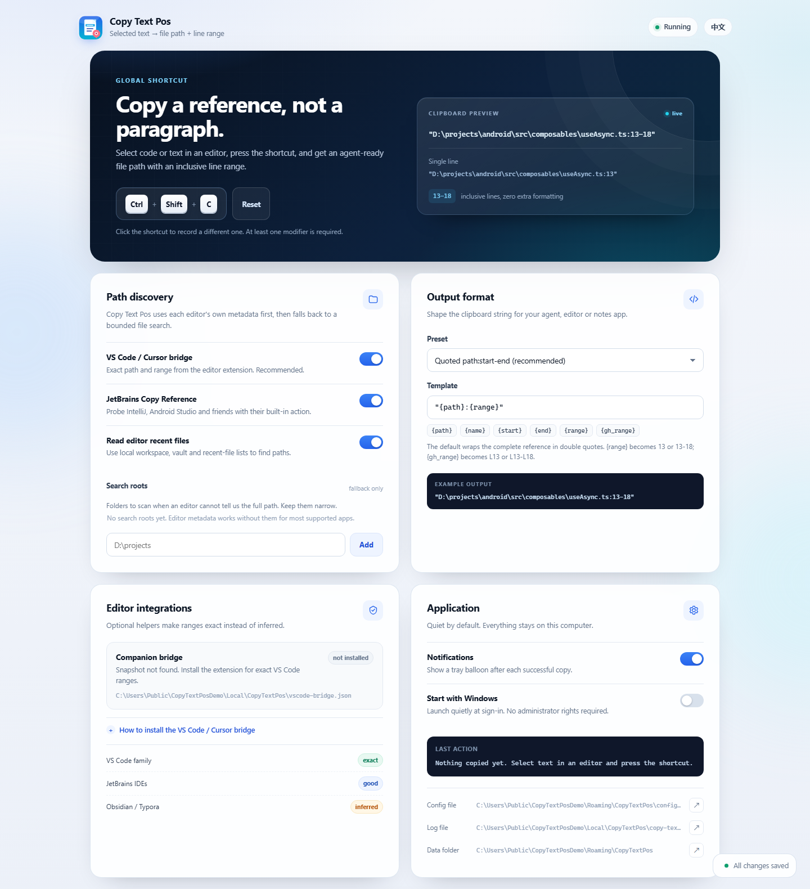
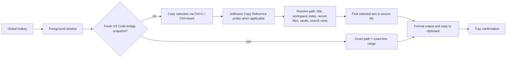

<p align="center">
  
</p>

<h1 align="center">Copy Text Pos</h1>

<p align="center">
  <b>Select text in an editor. Press one hotkey. Paste a precise file reference.</b>
</p>

<p align="center">
  <code>"D:\projects\android\src\composables\useAsync.ts:13-18"</code>
</p>

<p align="center">
  <a href="README.zh-CN.md">简体中文</a> ·
  <a href="#quick-start">Quick start</a> ·
  <a href="#editor-support">Editor support</a> ·
  <a href="#why-not-uia">Why not UIA?</a> ·
  <a href="#build-from-source">Build</a>
</p>

<p align="center">
  
  
  
  
</p>

Copy Text Pos is a tiny Windows tray utility for people who paste code context into
AI agents, issue trackers, terminals, or notes. It turns the current editor
selection into an absolute path with an inclusive line range — the format most
coding agents understand:

```text
"D:\projects\android\src\composables\useAsync.ts:13-18"
```

It works without plugins in many editors. For VS Code, Cursor, Windsurf and
VSCodium, an optional bridge extension makes the path **and range exact**, even
for unsaved buffers.



<p align="center"><sub>English settings page. <a href="docs/settings-zh.png">中文截图</a></sub></p>

---

## Why

A coding agent can do much better work when you give it:

- the correct file, not a paragraph of code;
- an exact line range, not a guess;
- a reference that survives copy/paste into a chat box.

Doing that manually means copying a path, opening the file, finding the line
numbers, and formatting the result. Copy Text Pos reduces it to one keystroke.

## Features

- **Global hotkey** — default `Ctrl+Shift+C`, configurable by recording a new
  combination in the tray settings page.
- **Configurable passthrough apps** — list executables for which the global
  shortcut should be released. It defaults to `explorer.exe`, so Explorer's own
  `Ctrl+Shift+C` “Copy as path” keeps working. The shortcut is re-registered
  when you switch back to an editor.
- **Native Windows tray app** — one self-contained `.exe`, no Electron, no
  runtime, no background browser.
- **Exact VS Code-family ranges** — optional companion extension reports active
  file and selection lines directly, including dirty (unsaved) buffers.
- **Layered fallbacks** — window titles, recent workspace indexes, Obsidian
  vault metadata, Typora history, JetBrains *Copy Reference*, and bounded source
  searches.
- **Polite clipboard handling** — if a copy fails, the previous clipboard is
  restored instead of being destroyed.
- **Quoted by default** — the complete `path:line` reference is wrapped in
  double quotes, ready to paste into an agent or chat box. Templates can switch
  back to an unquoted form or emit GitHub/Markdown references.
- **Agent-friendly templates** — `path:start-end`, always-range, GitHub
  `#L13-L18`, Markdown links, or your own placeholders.
- **Local only** — no network calls, no telemetry. Settings are served by a
  token-protected loopback server.
- **Bilingual UI** — English and 简体中文, following the browser language with a
  manual toggle.

## Quick start

1. Download `copy-text-pos.exe` from Releases, or [build it](#build-from-source).
2. Run it. A tray icon appears. The default hotkey is **`Ctrl+Shift+C`**.
3. Select text in an editor and press the shortcut.
4. Paste. You should get a reference like
   `"D:\projects\android\src\composables\useAsync.ts:13-18"`.
5. Right-click the tray icon → **Settings…** to change the shortcut, output
   template, search roots and integrations.

The app writes its config to:

```text
%APPDATA%\CopyTextPos\config.json
```

Logs (which never contain selected text) go to:

```text
%LOCALAPPDATA%\CopyTextPos\copy-text-pos.log
```

> **Hotkey conflicts:** Windows gives global hotkeys to one application at a
> time. If the shortcut does not work, change it in Settings. Some clipboard
> tools use low-level keyboard hooks and can interfere even when
> `RegisterHotKey` succeeds. For apps with their own `Ctrl+Shift+C` action, add
> their executable names to `releaseHotkeyProcesses`; Explorer is included by
> default. While one of those apps is foreground, Copy Text Pos releases the
> hotkey and re-registers it when you switch away.

## Editor support

There is no universal Windows API that returns “the full source path and the
source line numbers of the current text selection”. Support is therefore
layered, and some editors need a little configuration.

Legend:

- **Exact** — metadata from the editor, no guessing.
- **Good** — path is obtained from editor state; range is inferred from the
  selected text.
- **Inferred** — path/range depend on the window title or configured search
  roots.
- **—** — not supported.

| Editor | Path | Line range | How it works |
|---|---|---|---|
| **VS Code, Cursor, Windsurf, VSCodium** + bridge | ✅ Exact | ✅ Exact | Companion extension writes active file + selection range |
| **VS Code family** without bridge | 🟢 Good | 🟡 Inferred | Window title, workspaceStorage index, selected-text search |
| **IntelliJ IDEA, Android Studio, PyCharm, WebStorm, GoLand, CLion, Rider, RustRover, PhpStorm, RubyMine** | ✅ Exact | 🟡 Inferred | Built-in *Copy Reference* is probed; end line comes from selected-text search |
| **Obsidian** | 🟢 Good | 🟡 Inferred | `obsidian.json` vault registry; Markdown-aware source search |
| **Typora** | 🟢 Good | 🟡 Inferred | `history.data` recent files; Markdown-aware source search |
| **Sublime Text, Notepad++, EmEditor, Neovim GUI, Windows Notepad** | 🟡 Depends | 🟡 Inferred | Full path in window title or configured search roots; selected-text search |
| **Terminals, browsers, Office documents, PDFs** | — | — | No plain source file with a selection |

**The bridge is the only way to get a fully exact path and range.** Without it,
the app still works well when:

- the file name in the title is unique in the opened workspace/recent files, or
- you add the project folder under **Search roots**, or
- you set `window.title` to include the absolute file path:

```json
"window.title": "${activeEditorLong}${separator}${rootName}${separator}${appName}"
```

JetBrains IDEs use the stock **Copy Reference** action (`Ctrl+Alt+Shift+C`). If
you changed that keymap, either restore it or switch off *JetBrains Copy
Reference* and use search roots instead.

Obsidian and Typora return line numbers from the Markdown **source**. Selecting
rendered text with bold, links, tables or embedded HTML can make the range
uncertain; plain paragraphs work best.

See [docs/editor-support.md](docs/editor-support.md) for per-editor setup and
caveats. The Chinese version is [here](docs/editor-support.zh-CN.md).

### Install the optional VS Code / Cursor bridge

The bridge is included in this repository under
[`integrations/vscode`](integrations/vscode/README.md). A `.vsix` is attached to
GitHub releases. To build it yourself:

```powershell
cd integrations/vscode
npm run package
code   --install-extension copy-text-pos-bridge-0.1.0.vsix
cursor --install-extension copy-text-pos-bridge-0.1.0.vsix
```

Reload the editor window. The bridge stores only file path, line range, app and
workspace names in:

```text
%LOCALAPPDATA%\CopyTextPos\vscode-bridge.json
```

It never writes the selected text. With a fresh bridge snapshot, the native app
does **not** send synthetic `Ctrl+C`, so your clipboard and selection are left
alone.

## How it works



Key implementation choices:

- **Clipboard capture** uses synthetic keyboard input (`keybd_event`) and checks
  that the clipboard sequence number changed. It waits for shortcut modifiers to
  be released and refuses to fire in native terminal windows, where `Ctrl+C`
  means SIGINT.
- **Path discovery** reads editor-owned metadata before scanning the file
  system. Searches are time-bounded (1.8 s by default), prune heavy directories
  (`node_modules`, `.git`, `dist`, …), and are cached.
- **Line mapping** finds the selected text in the file and converts the byte
  offset to 1-based inclusive lines. Exact, whitespace-insensitive and
  Markdown-aware passes are tried in that order.
- **Clipboard safety**: before sending `Ctrl+C`, the app snapshots the current
  clipboard. If anything fails, text (or non-text formats when possible) is
  restored. A successful run intentionally replaces the clipboard with the
  reference.

### Why not UIA?

**Short answer: Windows UI Automation (UIA) is useful for accessibility, but it
is not a reliable primary solution for “file path + source line range”.**

UIA can expose a control tree, names, values, selection patterns and
`TextPattern`. What it does *not* expose in any standard, cross-editor way is:

| What we need | What UIA typically gives |
|---|---|
| Absolute source file path | Window/document **name** only; no standard path property |
| Source line numbers | No source-line property. `TextRange` line units can be counted, but only when the editor exposes the full document, and it is slow on large files |
| Exact selection range | `TextPattern.GetSelection()` can work, but many editors expose a placeholder, UI chrome, or nothing until screen-reader mode is enabled |
| Unsaved buffer metadata | Nothing that identifies source line semantics |

In practice, Electron editors such as VS Code and Cursor often hide the editor
from UIA unless accessibility/screen-reader support is activated. JetBrains
IDEs use their own accessibility bridge. Counting UI text lines is not the same
as counting source lines when the editor folds code, wraps lines, or renders
Markdown. And UIA still does not tell us the file path.

So v0.1.7 uses a hybrid of **editor-native metadata + clipboard selection +
source search**, with an optional exact bridge for VS Code derivatives. UIA
might be added later for narrow jobs such as classifying the focused control
(editor vs. integrated terminal), but it is not a good foundation for the whole
feature.

Further reading: [UI Automation TextPattern overview](https://learn.microsoft.com/en-us/dotnet/framework/ui-automation/ui-automation-textpattern-overview)
and [IUIAutomationTextPattern](https://learn.microsoft.com/en-us/windows/win32/api/uiautomationclient/nn-uiautomationclient-iuiautomationtextpattern).

## Configuration

Open **tray icon → Settings…**. The page is served locally at a random
`127.0.0.1` port with a per-process secret in the URL.

| Setting | Default | Meaning |
|---|---|---|
| `hotkey` | `Ctrl+Shift+C` | Global shortcut, e.g. `Ctrl+Alt+Shift+F10` |
| `format` | `"{path}:{range}"` | Clipboard template; quotes are literal |
| `searchRoots` | `[]` | Folders scanned as a fallback |
| `enableVSCodeBridge` | `true` | Read the VS Code/Cursor snapshot |
| `enableJetBrainsReference` | `true` | Probe JetBrains *Copy Reference* |
| `enableEditorRecents` | `true` | Use workspace/vault/recent-file metadata |
| `notifications` | `true` | Tray balloon after successful copies |
| `startWithWindows` | `false` | Add a per-user Run registry entry |
| `releaseHotkeyProcesses` | `["explorer.exe"]` | Release the shortcut while any of these processes is foreground |
| `maxSearchMs` | `1800` | Upper bound for fallback source searches |

The shortcut parser accepts `Ctrl`/`Control`, `Shift`, `Alt`, `Win`/`Windows`
plus letters, digits, `F1`–`F24`, arrows, navigation keys and common punctuation
names. At least one modifier is required.

### Output templates

| Placeholder | Value for lines 13–18 |
|---|---|
| `{path}` | `D:\projects\app\src\useAsync.ts` |
| `{dir}` | `D:\projects\app\src` |
| `{name}` | `useAsync.ts` |
| `{ext}` | `ts` |
| `{start}` | `13` |
| `{end}` | `18` |
| `{line}` | `13` |
| `{range}` | `13-18` (or `13` for a single line) |
| `{gh_range}` | `L13-L18` (or `L13`) |

Useful templates:

```text
"{path}:{range}"                  ← default
"{path}:{start}-{end}"
{path}:{range}                    (unquoted)
{path}:{start}-{end}
{path}#L{start}-L{end}
[{name}]({path}#L{start}-L{end})
```

The quotes are ordinary literal characters in the template, so the copied text
is exactly `"D:\...\file.ts:13-18"`. Remove them or pick the unquoted preset if
your downstream tool does not want quoting. For a single-line selection,
`{range}` collapses to one number, which is what most agents expect.

## Privacy and safety

- **No network calls. No telemetry. No accounts.**
- Selected text is processed in memory. It is not written to the log or config.
- The bridge snapshot contains file path, line numbers, app/workspace names and
  timestamps only — never the selected text.
- On failure, the app restores the previous clipboard. Note that sending
  `Ctrl+C` can still be observed by Windows Clipboard History or a third-party
  clipboard manager; install the bridge to avoid synthetic copies in VS Code.
- The settings page binds to `127.0.0.1`, requires a random token in the path,
  rejects cross-origin POSTs, sets a strict CSP, and shuts down with the app.
- The executable is currently **not code-signed**. Windows SmartScreen may warn;
  build it yourself if you prefer.

## Limitations

- **Duplicate selected text**: without a bridge or a line hint in the title, the
  first occurrence is used. The tray notification and settings page may mention
  the ambiguity.
- **Unsaved changes**: fallback range search reads the file from disk. If the
  buffer differs, the range may be stale. The VS Code bridge solves this; for
  JetBrains, a *Copy Reference* anchor allows an estimated end line.
- **Rendered Markdown** in Obsidian/Typora may not match source syntax exactly.
- **Remote SSH / virtual documents**: local paths may not exist.
- **Elevated editors**: Windows UIPI blocks synthetic input from a non-elevated
  app into an elevated window. Run the editor and Copy Text Pos at the same
  integrity level.
- **Integrated terminals**: do not trigger the hotkey while a terminal panel has
  focus. Native terminal windows are skipped, but VS Code/Cursor expose terminal
  focus poorly to extensions; a bridge snapshot may refer to the last editor.
- **Windows 10**: the code targets Windows 10 1809+ and Windows 11, but testing
  is primarily on Windows 11. Please report Win10 issues.

## Build from source

Requirements:

- Windows 10/11 x64
- Go **1.22+**
- PowerShell 5.1+
- Optional: `windres` (GNU binutils) to regenerate the `.syso` icon/manifest
- Optional: Node.js 18+ for the VS Code bridge
- Optional: Python 3 + Pillow to regenerate icons

```powershell
git clone <this repository>
cd copy-text-pos
.\build.ps1 -Version 0.1.7 -Package
```

Outputs:

```text
bin\copy-text-pos.exe
bin\copy-text-pos.exe.sha256
bin\copy-text-pos-0.1.7-win-x64.zip
```

For a build with a console window (useful for debugging):

```powershell
.\build.ps1 -Version 0.1.7 -Console -Output bin\copy-text-pos-dev.exe
```

Tests:

```powershell
$env:GOARCH = "amd64"
$env:CGO_ENABLED = "0"
go test ./...
```

The optional integration test uses local editor metadata and is skipped by
default:

```powershell
$env:CTP_INTEGRATION = "1"
go test ./internal/locate -run TestResolverIntegrationCursor -v
```

The bridge extension:

```powershell
cd integrations/vscode
npm run package
```

Regenerate the embedded tray icon and executable resource:

```powershell
python scripts\generate_icon.py
.\scripts\gen-resources.ps1
```

## Project layout

```text
cmd/copy-text-pos/      Windows entry point, manifest, version resource
internal/app/           orchestration: hotkey → capture → resolve → clipboard
internal/capture/       selection copy session, clipboard snapshot
internal/locate/        title/recents/bridge/JetBrains resolution + search
internal/textmatch/     selected-text → source line range
internal/settings/      loopback HTTP API + embedded bilingual UI
internal/tray/          native notification icon, menu, message loop
internal/winapi/        cgo-free Win32/Shell/OLE bindings
integrations/vscode/    optional exact-range bridge extension
docs/                   screenshots and support notes
```

## Troubleshooting

**The shortcut does nothing.** Another app may own it, or a keyboard hook may
swallow it. Change the hotkey in Settings and check the log.

**“Could not determine the file path.”** Add the project folder to *Search
roots*. For VS Code/Cursor, install the bridge or include
`${activeEditorLong}` in `window.title`.

**The line range is wrong.** The file may be unsaved, the selected text may be
duplicated, or rendered Markdown may differ from source. Use the bridge for VS
Code, and save the file for other editors.

**“Nothing was selected.”** Some editors copy the current line when there is no
selection; others copy nothing. Select text first. Terminals are intentionally
not supported.

**Clipboard is unchanged after a failure.** That is intentional: the app
restores what you had before the hotkey press. Check the tray balloon and the
log for the reason.

**SmartScreen warning.** The build is unsigned. Use “More info → Run anyway” or
build from source.

## Contributing

Issues and pull requests are welcome. Please include:

- editor name/version and Windows version;
- the window title pattern (redact sensitive paths if needed);
- the log tail from `%LOCALAPPDATA%\CopyTextPos\copy-text-pos.log`;
- whether the VS Code bridge was active.

Do not paste selected content or secrets into a public issue.

## License

MIT — see [LICENSE](LICENSE). Third-party Go modules retain their own licenses
(`golang.org/x/sys`, `golang.org/x/text`).
