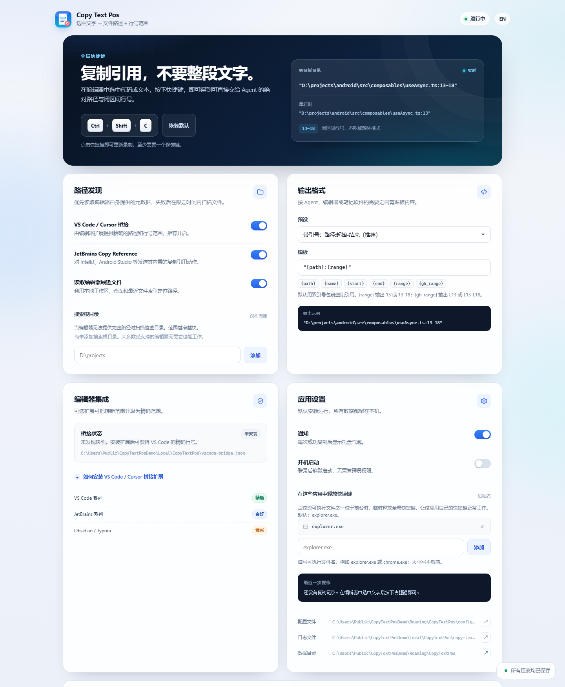
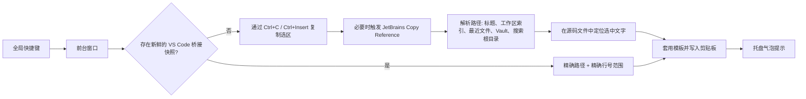

<p align="center">
  
</p>

<h1 align="center">Copy Text Pos</h1>

<p align="center">
  <b>在文本编辑器中选中文字，按一次快捷键，粘贴出精确的文件引用。</b>
</p>

<p align="center">
  <code>"D:\projects\android\src\composables\useAsync.ts:13-18"</code>
</p>

<p align="center">
  <a href="README.md">English</a> ·
  <a href="#快速开始">快速开始</a> ·
  <a href="#编辑器支持">编辑器支持</a> ·
  <a href="#为什么不直接用-uia">为什么不用 UIA？</a> ·
  <a href="#从源码构建">构建</a>
</p>

<p align="center">
  
  
  
  
</p>

Copy Text Pos 是一个 Windows 托盘小工具，适合把代码上下文粘贴给 AI Agent、
Issue、终端或笔记软件。它会把当前编辑器选区转换成带行号范围的绝对路径——
这是大多数编程 Agent 都能理解的格式：

```text
"D:\projects\android\src\composables\useAsync.ts:13-18"
```

很多编辑器无需插件即可使用。对于 VS Code、Cursor、Windsurf 和 VSCodium，
可选的桥接扩展可以让路径**和行号范围都精确**，即使文件尚未保存。



<p align="center"><sub>中文设置页。<a href="docs/settings-en.png">English screenshot</a></sub></p>

---

## 为什么需要它

给编程 Agent 提供以下信息，效果通常好得多：

- 正确的文件，而不是一大段代码；
- 精确的行号范围，而不是猜测；
- 一个可以直接粘贴到聊天框的引用。

手动完成这件事，需要复制路径、打开文件、找行号、拼格式。Copy Text Pos
把它压缩成一次快捷键。

## 功能

- **全局快捷键**：默认 `Ctrl+Shift+C`，可在托盘设置页中直接录制新的组合键。
- **可配置的快捷键让渡**：用列表指定哪些应用位于前台时释放全局快捷键，默认是
  `explorer.exe`，因此资源管理器自带的 `Ctrl+Shift+C`“复制文件路径”继续可用；
  切回编辑器后自动重新注册。
- **原生 Windows 托盘应用**：单个自包含 `.exe`，不使用 Electron，不需要运行时，
  不常驻浏览器。
- **VS Code 系列精确范围**：可选伴生扩展直接上报当前文件与选区行号，未保存的
  文件也支持。
- **分层兜底**：窗口标题、最近工作区索引、Obsidian Vault 元数据、Typora 历史、
  JetBrains *Copy Reference*，最后才是限定范围的源码搜索。
- **温和的剪贴板处理**：如果复制失败，会恢复你原来的剪贴板，而不是直接覆盖。
- **默认加双引号**：完整的 `路径:行号` 引用会被双引号包裹，可直接粘贴给 Agent
  或聊天框；也可以在模板中切换为不带引号或 GitHub/Markdown 格式。
- **面向 Agent 的模板**：`路径:起始-结束`、始终范围、GitHub `#L13-L18`、
  Markdown 链接，或自定义占位符。
- **纯本地**：无网络请求、无遥测。设置页由带随机令牌的本地回环服务提供。
- **中英双语界面**：跟随浏览器语言，也可手动切换。

## 快速开始

1. 从 Releases 下载 `copy-text-pos.exe`，或[从源码构建](#从源码构建)。
2. 运行。任务栏通知区域会出现图标，默认快捷键为 **`Ctrl+Shift+C`**。
3. 在编辑器中选中文字，按下快捷键。
4. 粘贴。你会得到类似
   `"D:\projects\android\src\composables\useAsync.ts:13-18"` 的引用。
5. 右键托盘图标 → **设置…**，可以修改快捷键、输出模板、搜索根目录和各项集成。

配置文件位于：

```text
%APPDATA%\CopyTextPos\config.json
```

日志（不包含选中文字）位于：

```text
%LOCALAPPDATA%\CopyTextPos\copy-text-pos.log
```

> **快捷键冲突：** Windows 的全局快捷键同一时间只能由一个程序注册。如果快捷键
> 无效，请在设置中更换。部分剪贴板工具使用低级键盘钩子，即使
> `RegisterHotKey` 成功也可能拦截按键。对自带 `Ctrl+Shift+C` 动作的应用，把
> 可执行文件名加入 `releaseHotkeyProcesses`；默认包含 Explorer。列表中的应用
> 位于前台时应用释放快捷键，切走后重新注册。

## 编辑器支持

Windows 没有统一的 API 可以同时返回“当前选区所属的完整源文件路径和源码行号”。
因此支持是分层的，部分编辑器需要少量配置。

图例：

- **精确**：来自编辑器自身元数据，不猜测。
- **良好**：路径来自编辑器状态，行号通过搜索选中文字推断。
- **推断**：路径/行号依赖窗口标题或搜索根目录。
- **—**：不支持。

| 编辑器 | 路径 | 行号范围 | 实现方式 |
|---|---|---|---|
| **VS Code、Cursor、Windsurf、VSCodium** + 桥接扩展 | ✅ 精确 | ✅ 精确 | 伴生扩展直接上报当前文件与选区范围 |
| **VS Code 系列** 无桥接 | 🟢 良好 | 🟡 推断 | 窗口标题、workspaceStorage 索引、选中文本搜索 |
| **IntelliJ IDEA、Android Studio、PyCharm、WebStorm、GoLand、CLion、Rider、RustRover、PhpStorm、RubyMine** | ✅ 精确 | 🟡 推断 | 自动触发内置 *Copy Reference*；结束行由选中文本搜索得出 |
| **Obsidian** | 🟢 良好 | 🟡 推断 | 读取 `obsidian.json` Vault 索引；Markdown 感知搜索 |
| **Typora** | 🟢 良好 | 🟡 推断 | 读取 `history.data` 最近文件；Markdown 感知搜索 |
| **Sublime Text、Notepad++、EmEditor、Neovim GUI、Windows 记事本** | 🟡 视配置 | 🟡 推断 | 窗口标题中的完整路径，或搜索根目录；选中文本搜索 |
| **终端、浏览器、Office 文档、PDF** | — | — | 不是带选区的纯文本源文件 |

**桥接扩展是获得完全精确范围的唯一方式；其他方案都属于“尽可能准确”。**
没有桥接时，以下情况通常也能正常使用：

- 标题中的文件名在打开的工作区/最近文件中唯一；或
- 在 **搜索根目录** 中添加项目目录；或
- 将 VS Code 的 `window.title` 设置为包含绝对路径：

```json
"window.title": "${activeEditorLong}${separator}${rootName}${separator}${appName}"
```

JetBrains 系列使用内置的 **Copy Reference** 动作（默认
`Ctrl+Alt+Shift+C`）。如果你改过该快捷键，可以恢复默认，或关闭
*JetBrains Copy Reference* 后改用搜索根目录。

Obsidian 和 Typora 返回的是 Markdown **源码**行号。选中经过渲染的粗体、链接、
表格或内嵌 HTML 时，范围可能不准确；普通段落效果最好。

逐编辑器的配置与限制见 [docs/editor-support.zh-CN.md](docs/editor-support.zh-CN.md)，
英文版见 [docs/editor-support.md](docs/editor-support.md)。

### 安装可选的 VS Code / Cursor 桥接扩展

扩展源码位于 [`integrations/vscode`](integrations/vscode/README.md)，GitHub
Release 中会附带 `.vsix`。也可以自行打包：

```powershell
cd integrations/vscode
npm run package
code   --install-extension copy-text-pos-bridge-0.1.0.vsix
cursor --install-extension copy-text-pos-bridge-0.1.0.vsix
```

重载编辑器窗口。桥接扩展只把文件路径、行号、应用名、工作区名和写入时间写到：

```text
%LOCALAPPDATA%\CopyTextPos\vscode-bridge.json
```

它**不会**写入选中文字。当桥接快照有效时，原生应用不会发送模拟 `Ctrl+C`，
因此不会打扰你的剪贴板和选区。

## 工作原理



关键实现：

- **剪贴板捕获**：使用合成键盘输入，并检查剪贴板序列号是否变化；等待快捷键
  修饰键释放后再发送复制。原生终端窗口会被跳过，因为那里的 `Ctrl+C` 是
  SIGINT。
- **路径发现**：优先读取编辑器自己的元数据，再扫描文件系统。扫描默认限制在
  1.8 秒内，跳过 `node_modules`、`.git`、`dist` 等大目录，并带缓存。
- **行号映射**：在文件中查找选中文字，把字节偏移换算成 1-based 闭区间行号；
  依次尝试精确匹配、空白不敏感匹配、Markdown 感知匹配。
- **剪贴板安全**：发送 `Ctrl+C` 前保存当前剪贴板快照。任何环节失败都会恢复
  原来的文本（非文本格式尽可能恢复）。成功时则按设计写入路径引用。

### 为什么不直接用 UIA？

**简短回答：Windows UI Automation（UIA）很适合辅助功能，但不足以作为“文件路径
+ 源码行号”的主要实现方案。**

UIA 可以提供控件树、名称、值、选中模式、`TextPattern` 等。但在跨编辑器的标准
接口中，它并不提供：

| 我们需要 | UIA 通常能提供 |
|---|---|
| 源文件绝对路径 | 只有窗口/文档 **名称**，没有标准路径属性 |
| 源码行号 | 没有源码行号属性。`TextRange` 的“行”单位只有在编辑器暴露完整文档时才可数，大文件很慢 |
| 精确选区范围 | `TextPattern.GetSelection()` 有时可用；但很多编辑器只暴露占位符、UI 结构，或需要先开启屏幕阅读器模式 |
| 未保存缓冲区语义 | 无法判断对应磁盘源码的哪几行 |

实际测试中，VS Code/Cursor 这类 Electron 编辑器在未开启辅助功能/屏幕阅读器
模式时，往往只提供 “editor is not accessible” 的占位文本；JetBrains 使用自己的
辅助功能桥接。即使能数出 UI 文本行，代码折叠、自动换行、Markdown 渲染也会让
它和源码行号不一致。而路径问题仍然没有解决。

因此 v0.1.5 采用**编辑器原生元数据 + 剪贴板选区 + 源码搜索**的混合方案，并为
VS Code 系列提供精确的桥接扩展。未来也许会用 UIA 做很窄的辅助判断（例如当前
焦点是编辑器还是内置终端），但不会把它作为主数据源。

延伸阅读：[UI Automation TextPattern 概述](https://learn.microsoft.com/en-us/dotnet/framework/ui-automation/ui-automation-textpattern-overview)
与 [IUIAutomationTextPattern](https://learn.microsoft.com/en-us/windows/win32/api/uiautomationclient/nn-uiautomationclient-iuiautomationtextpattern)。

## 配置

打开 **托盘图标 → 设置…**。页面由随机 `127.0.0.1` 端口提供，URL 中包含每个
进程独立生成的随机令牌。

| 配置项 | 默认值 | 含义 |
|---|---|---|
| `hotkey` | `Ctrl+Shift+C` | 全局快捷键，例如 `Ctrl+Alt+Shift+F10` |
| `format` | `"{path}:{range}"` | 剪贴板模板，引号为普通字符 |
| `searchRoots` | `[]` | 兜底搜索的目录 |
| `enableVSCodeBridge` | `true` | 读取 VS Code/Cursor 快照 |
| `enableJetBrainsReference` | `true` | 触发 JetBrains *Copy Reference* |
| `enableEditorRecents` | `true` | 使用工作区、Vault、最近文件元数据 |
| `notifications` | `true` | 成功后显示托盘气泡 |
| `startWithWindows` | `false` | 写入当前用户的启动项 |
| `releaseHotkeyProcesses` | `["explorer.exe"]` | 这些进程位于前台时释放快捷键 |
| `maxSearchMs` | `1800` | 兜底源码搜索的时间上限 |

快捷键支持 `Ctrl`/`Control`、`Shift`、`Alt`、`Win`/`Windows`，以及字母、数字、
`F1`–`F24`、方向键、导航键和常用标点名称。至少需要一个修饰键。

### 输出模板

| 占位符 | 第 13–18 行时的值 |
|---|---|
| `{path}` | `D:\projects\app\src\useAsync.ts` |
| `{dir}` | `D:\projects\app\src` |
| `{name}` | `useAsync.ts` |
| `{ext}` | `ts` |
| `{start}` | `13` |
| `{end}` | `18` |
| `{line}` | `13` |
| `{range}` | `13-18`（单行时为 `13`） |
| `{gh_range}` | `L13-L18`（单行时为 `L13`） |

常用模板：

```text
"{path}:{range}"                  ← 默认
"{path}:{start}-{end}"
{path}:{range}                    （不带引号）
{path}:{start}-{end}
{path}#L{start}-L{end}
[{name}]({path}#L{start}-L{end})
```

引号是模板里的普通字符，所以最终复制内容就是 `"D:\...\file.ts:13-18"`。
如果下游工具不需要引号，可以删掉引号或选择“不带引号”的预设。单行选区时，
`{range}` 会自动折叠为一个数字，符合大多数 Agent 的预期。

## 隐私与安全

- **无网络请求、无遥测、无需账号。**
- 选中文字只在内存中处理，不会写入日志或配置。
- 桥接快照只包含路径、行号、应用/工作区名称和时间戳，**不包含选中文字**。
- 失败时会恢复原剪贴板。但模拟 `Ctrl+C` 仍可能被 Windows 剪贴板历史或第三方
  剪贴板管理器记录。介意的话请安装桥接扩展，在 VS Code 中完全避免模拟复制。
- 设置页只监听 `127.0.0.1`，路径中包含随机令牌，拒绝跨站 POST，设置严格 CSP，
  并随应用退出而关闭。
- 可执行文件目前**没有代码签名**，Windows SmartScreen 可能提示。介意时可自行
  从源码构建。

## 已知限制

- **重复文本**：没有桥接或标题行号提示时，默认取第一个匹配位置；设置页和托盘
  通知会提示存在歧义。
- **未保存修改**：兜底行号搜索读取磁盘文件。缓冲区与磁盘不一致时行号可能过期。
  VS Code 桥接可解决；JetBrains 在拿到 *Copy Reference* 锚点后可估算结束行。
- **Markdown 渲染**：Obsidian/Typora 中选中的是渲染后文本时，可能与源码语法
  不完全一致。
- **远程 SSH/虚拟文档**：本地可能不存在对应路径。
- **管理员权限窗口**：Windows UIPI 会阻止非管理员程序向管理员窗口发送模拟
  输入。请让编辑器和 Copy Text Pos 处于相同的完整性级别。
- **内置终端**：不要在终端面板获得焦点时触发快捷键。原生终端窗口会被跳过，
  但 VS Code/Cursor 扩展 API 很难判断终端焦点，桥接快照可能仍指向最后一次
  编辑器选区。
- **Windows 10**：代码面向 Windows 10 1809+ 和 Windows 11，但主要在 Windows
  11 上测试。欢迎反馈 Win10 问题。

## 从源码构建

依赖：

- Windows 10/11 x64
- Go **1.22+**
- PowerShell 5.1+
- 可选：`windres`（GNU binutils），用于重新生成 `.syso` 图标/清单资源
- 可选：Node.js 18+，用于构建 VS Code 桥接扩展
- 可选：Python 3 + Pillow，用于重新生成图标

```powershell
git clone <本仓库地址>
cd copy-text-pos
.\build.ps1 -Version 0.1.5 -Package
```

输出：

```text
bin\copy-text-pos.exe
bin\copy-text-pos.exe.sha256
bin\copy-text-pos-0.1.5-win-x64.zip
```

带控制台窗口的开发构建（便于调试）：

```powershell
.\build.ps1 -Version 0.1.5 -Console -Output bin\copy-text-pos-dev.exe
```

测试：

```powershell
$env:GOARCH = "amd64"
$env:CGO_ENABLED = "0"
go test ./...
```

可选的本地编辑器集成测试默认跳过：

```powershell
$env:CTP_INTEGRATION = "1"
go test ./internal/locate -run TestResolverIntegrationCursor -v
```

桥接扩展：

```powershell
cd integrations/vscode
npm run package
```

重新生成托盘图标和可执行文件资源：

```powershell
python scripts\generate_icon.py
.\scripts\gen-resources.ps1
```

## 项目结构

```text
cmd/copy-text-pos/      Windows 入口、清单、版本资源
internal/app/           编排：快捷键 → 捕获 → 解析 → 剪贴板
internal/capture/       选区复制会话、剪贴板快照
internal/locate/        标题/最近文件/桥接/JetBrains 解析 + 搜索
internal/textmatch/     选中文字 → 源码行号范围
internal/settings/      本地 HTTP API + 内嵌双语界面
internal/tray/          原生托盘图标、菜单、消息循环
internal/winapi/        无 cgo 的 Win32/Shell/OLE 绑定
integrations/vscode/    可选的精确范围桥接扩展
docs/                   截图与支持说明
```

## 常见问题

**按快捷键没有反应。** 可能被其他程序占用，或被键盘钩子拦截。在设置中更换
快捷键，并查看日志。

**提示“无法确定文件路径”。** 在 *搜索根目录* 中添加项目目录。VS Code/Cursor
请安装桥接扩展，或在 `window.title` 中加入 `${activeEditorLong}`。

**行号不正确。** 文件可能未保存、选中文字有重复，或渲染后的 Markdown 与源码
不同。VS Code 请用桥接扩展；其他编辑器请先保存文件。

**提示“没有选中文字”。** 有些编辑器在没有选区时会复制当前行，有些什么都不复制。
请先选中文字。终端窗口是有意不支持的。

**失败后剪贴板没变。** 这是有意设计：应用会恢复按下快捷键之前的内容。失败原因
请看托盘气泡和日志。

**SmartScreen 警告。** 构建未签名，选择“更多信息 → 仍要运行”，或自行构建。

## 参与贡献

欢迎提交 Issue 和 PR。报告问题时请附上：

- 编辑器名称/版本和 Windows 版本；
- 窗口标题的格式（必要时脱敏）；
- `%LOCALAPPDATA%\CopyTextPos\copy-text-pos.log` 的末尾日志；
- VS Code 桥接是否处于活动状态。

请勿在公开 Issue 中粘贴选中内容或密钥。

## 许可证

MIT，详见 [LICENSE](LICENSE)。第三方 Go 模块保留各自许可证
（`golang.org/x/sys`、`golang.org/x/text`）。
